# ATPD

[English](README.md) · Deutsch

Eine schlanke Startoberfläche für Philips Android TV: Kameras, Ambilight, Philips Hue HDMI-Geräte und TV-Netzwerkstatus, bedienbar mit der TV-Fernbedienung.

Als Android-App installieren und bei Bedarf als Home-Oberfläche zuordnen.

**0.10.0 · experimentelle Beta.** Die Repository-Dokumentation ist auf Englisch; TV-Oberfläche und lokale Web-Einstellungen bleiben auf Deutsch. Am TV erscheinen kein Projektname und kein Logo. In Android heißt die App **TV-Dashboard**.

## So sieht es aus

Native Ansichten aus einem separaten Simulator mit künstlichen Kameras, Lichtzuständen und HDMI-Einträgen. Das sind Screenshots der Anwendung, keine Entwurfsbilder. Die Web-Screenshots stammen aus einer separaten lokalen Vorschau mit erfundenen Daten. Private Kamerabilder, Zugangscodes und echte Netzwerkdaten sind nicht enthalten.

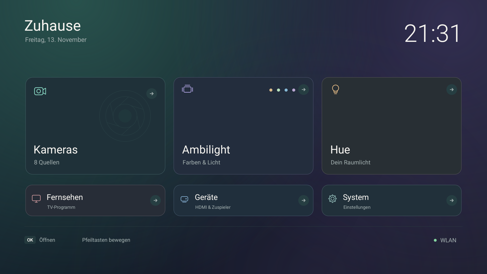

| HDMI-Geräte | Kameraübersicht |
| --- | --- |
| 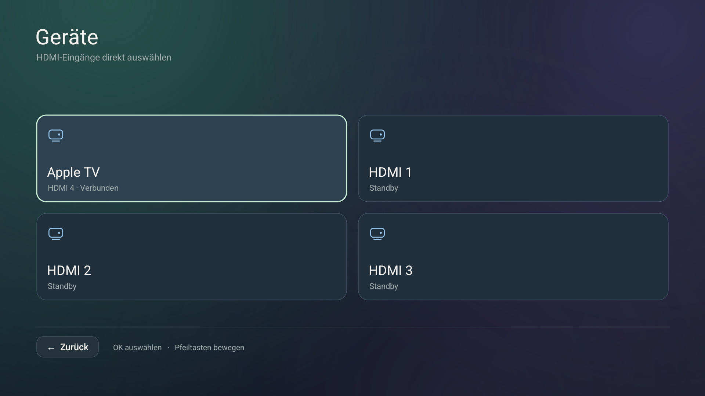 | 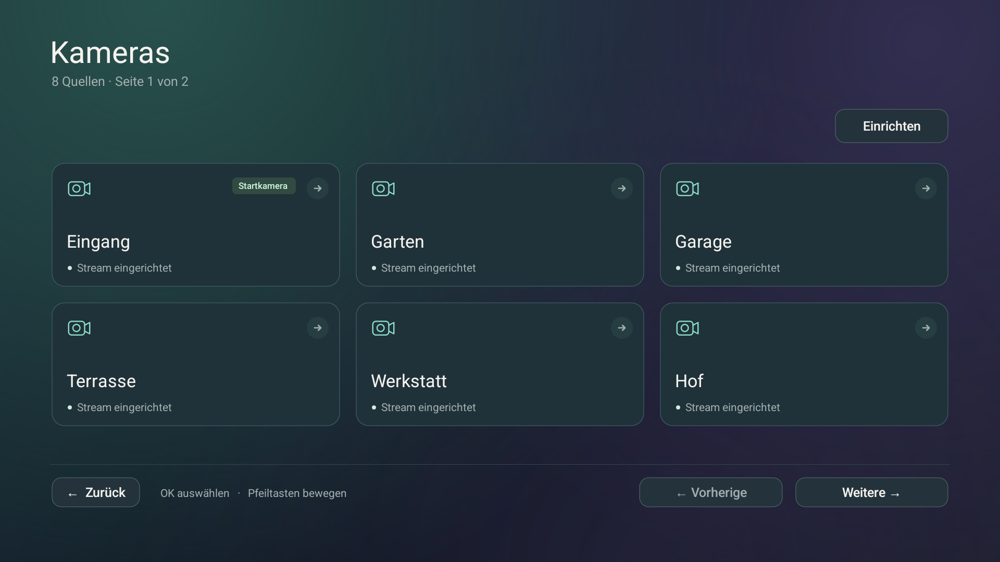 |
| **Ambilight** | **Philips Hue** |
| 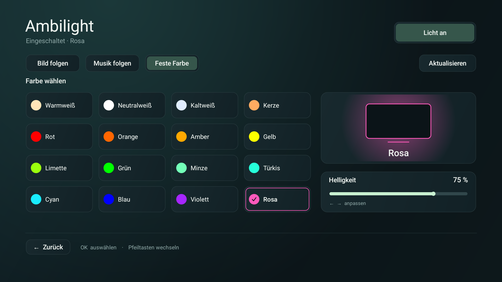 | 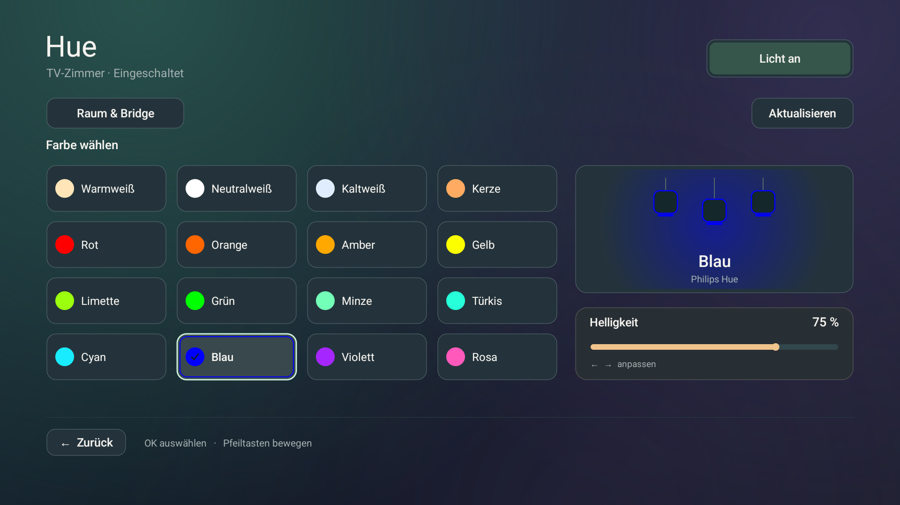 |
| **System** | **Bildschirmschoner** |
| 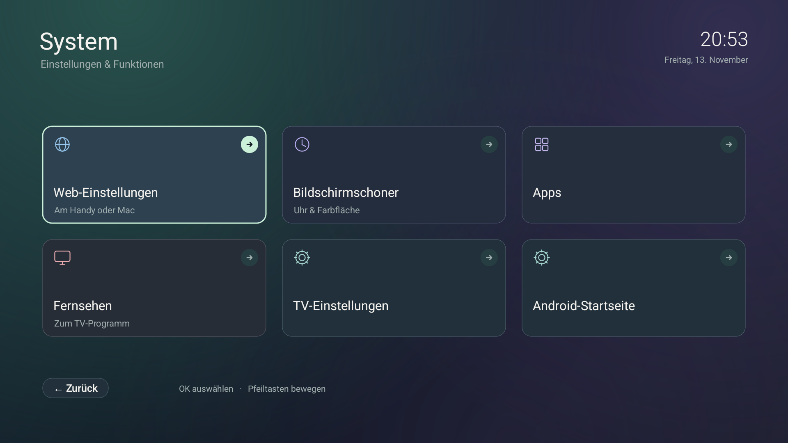 | 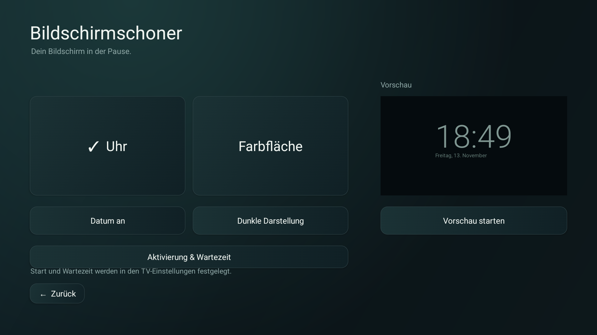 |
| **TV-Netzwerkstatus** | **Lokale Web-Einstellungen** |
| 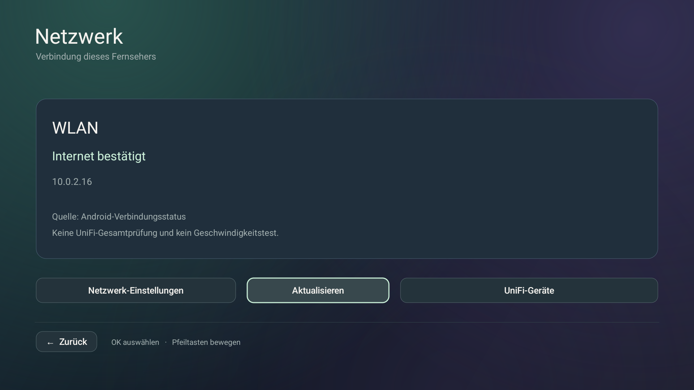 | 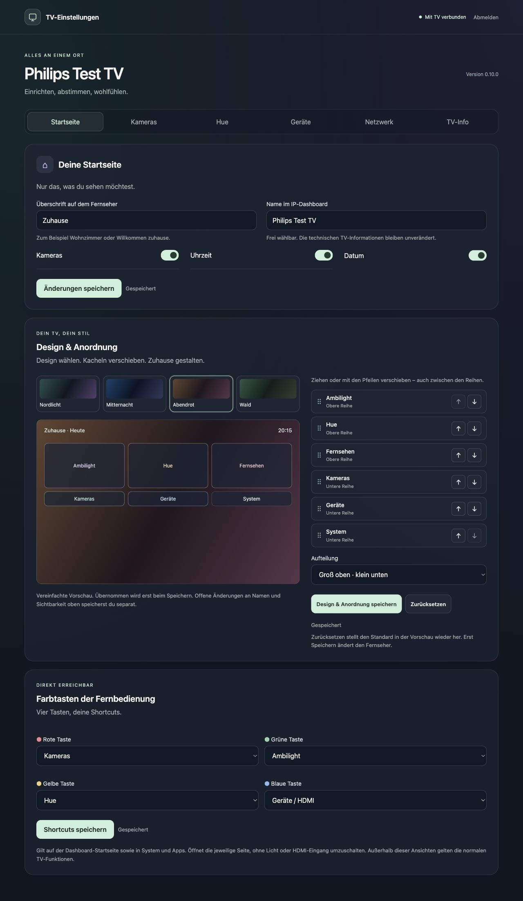 |
| **Lokale UniFi-Geräte** | **TV-Info und Wartung** |
| 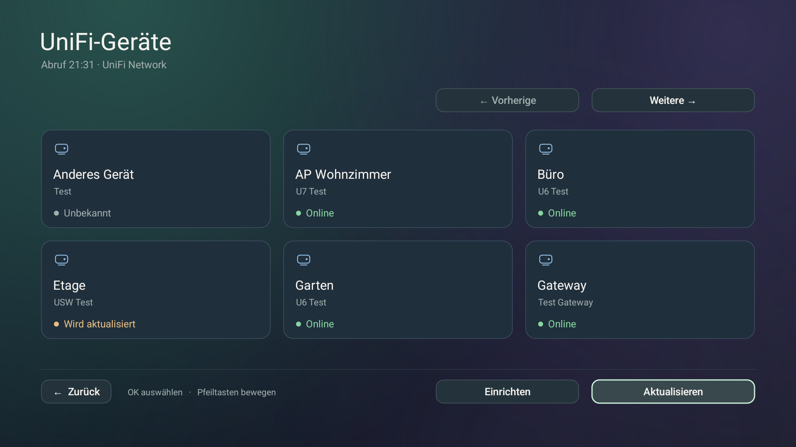 | 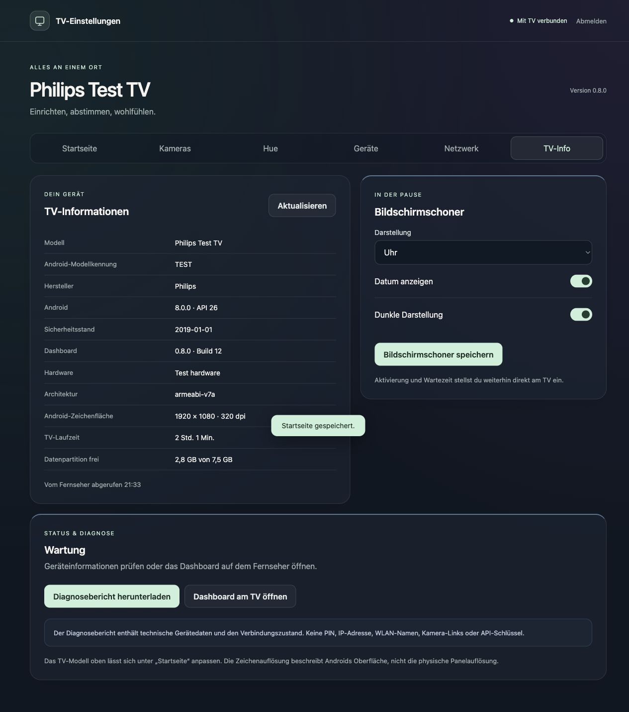 |

[Oberfläche und Fernbedienung (Englisch)](docs/UI.md) · [Apps-Screenshot](docs/images/apps.png)


<details>
<summary>Vier Designs mit eigener Kachel-Reihenfolge</summary>

| Nordlicht | Mitternacht |
| --- | --- |
| 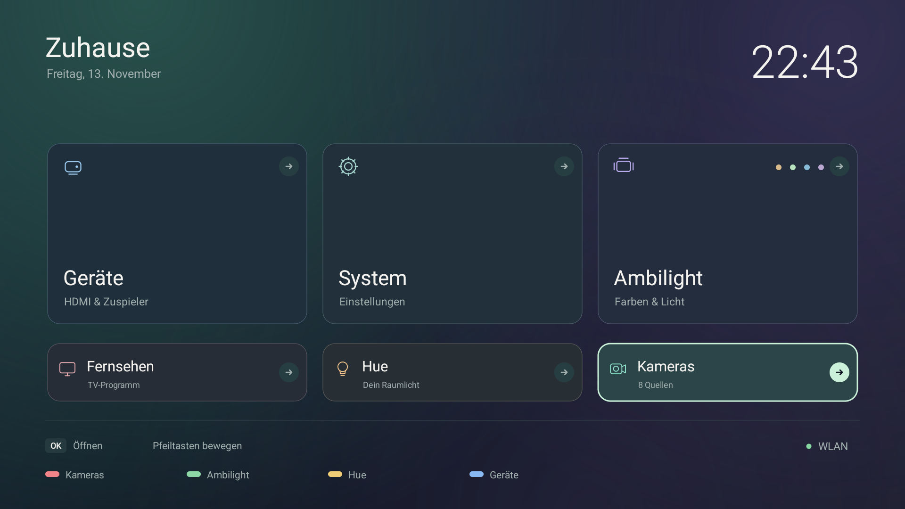 | 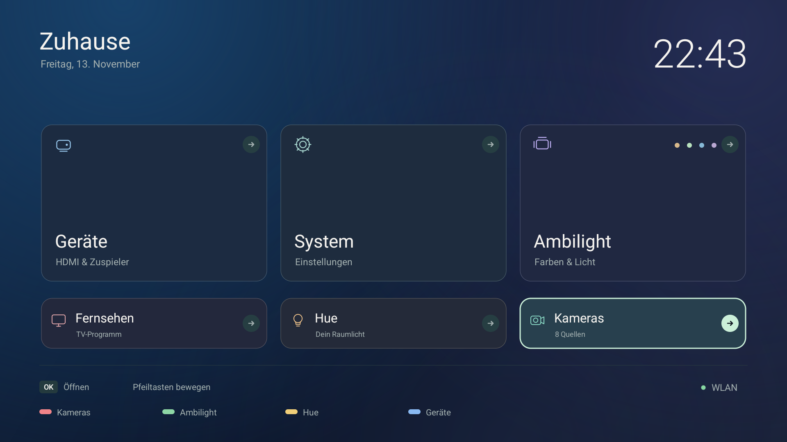 |
| **Abendrot** | **Wald** |
| 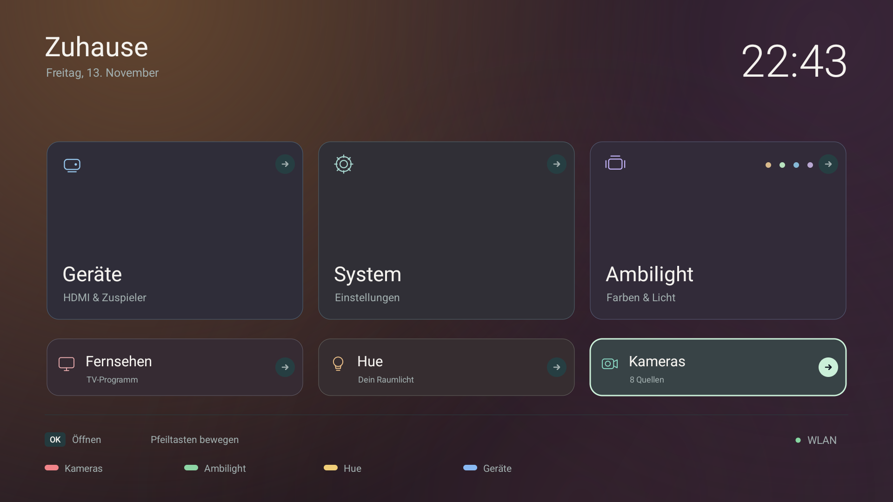 | 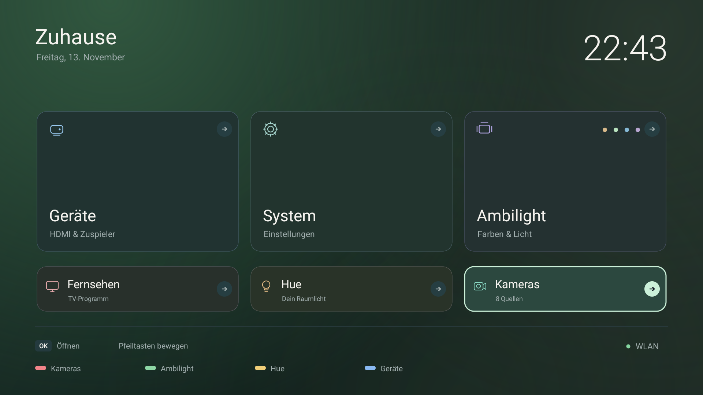 |

Native Emulator-Screenshots mit Testdaten und eigener Reihenfolge. Die Kamera-Kachel steht in der kleinen Reihe; alle Ziele bleiben erreichbar.

</details>

## Funktionen

- Vier TV-Designs (**Nordlicht, Mitternacht, Abendrot, Wald**) und verschiebbare Startseiten-Kacheln. Unter **Startseite → Design & Anordnung** Kacheln zwischen den Reihen ziehen oder per Pfeilen verschieben. Wahlweise groß oben/klein unten oder alle gleich groß. Vorschau und Zurücksetzen ändern den TV erst nach dem Speichern. [Editor](docs/images/web-design.jpg) · [Mobil](docs/images/web-design-mobile.jpg).

- Optionale Hue-Automatik unter **Hue → Hue mit dem TV ausschalten**: standardmäßig aus, nur für den ausgewählten Raum, ohne automatisches Wiedereinschalten und mit Anzeige des letzten Versuchs. Der reale Standby-Test am Philips steht noch aus; bei Stromverlust oder fehlender Bridge-Verbindung ist kein zuverlässiger Befehl möglich.

- Vier belegbare Farbtasten: Rot → Kameras, Grün → Ambilight, Gelb → Hue, Blau → Geräte. Im IP-Dashboard unter **Startseite → Farbtasten der Fernbedienung** änderbar. Sie öffnen Seiten aus Home/System/Apps.

- Aufgeräumte Startseite mit großen Fokusflächen, TV-Zugriff, Geräten und System.
- Bis zu 24 eingerichtete Kameras, sechs pro Übersichtsseite und jeweils ein Stream im Vollbild. Die Übersichtsseite bleibt bei der Rückkehr aus Einstellungen erhalten.
- Ambilight-Modi, 16 benannte Farben, Lichtvorschau und Helligkeit per Fernbedienung oder Berührung.
- Lokale Hue-Bridge-Kopplung mit bewusster Raumauswahl, Schalten, unterstützten Farben, Helligkeit und Szenen dieses Raums. Home Assistant ist nicht nötig.
- HDMI-Erkennung über Androids TV-Eingangsdienst. Vorhandene CEC-Namen kennzeichnen Geräte; die Auswahl übergibt den Eingang an die TV-App des Fernsehers.
- Bildschirmschoner als Uhr oder Farbfläche, Datum, dunkle Darstellung, Vorschau und Zugang zu den Aktivierungseinstellungen des TVs.
- Eigene Überschrift auf dem TV und separater Name im IP-Dashboard, dauerhaft auf dem TV gespeichert. TV-Info zeigt unabhängig davon das separat hinterlegte Verkaufsmodell und die von Android gemeldete Kennung. Unter **TV-Modell ergänzen** lässt sich die Verkaufsbezeichnung eintragen; ohne Eintrag steht dort **Nicht hinterlegt**.
- Eigener Web-Bereich TV-Info/Wartung mit Android-/App-/Hardwaredaten, Laufzeit, Speicher, Schoneroptionen, Diagnosebericht ohne Zugangsdaten und gezieltem Dashboard-Aufruf.
- Optionale lokale UniFi-Network-Geräteliste für eingebundene Access Points, Switches und Gateway. Mit bewusster Standortwahl, mehreren Geräteseiten und klar markierten veralteten/unbekannten Zuständen. Die Prüfung am echten Controller steht noch aus. [Einrichtung (Englisch)](docs/NETWORK.md#local-unifi-network-inventory).
- Responsive lokale HTTPS-Einstellungen für Startseite, Kameras, Hue-Kopplung/Raum, HDMI-Übersicht, Netzwerkstatus und TV-Informationen, mit PIN-Anmeldung und geschützten Sitzungen. Kamera-/Hue-Konfiguration bleibt verschlüsselt auf dem TV.
- Kompakte Netzwerkanzeige auf der Startseite mit kleinem Statuspunkt und aktivem WLAN-Namen, sofern Android ihn freigibt. Grün bedeutet von Android bestätigten Internetzugang, Gelb unbestätigten Zustand und Grau getrennt/unbekannt. Passiv und ohne Konto: **Verbindung dieses Fernsehers, keine UniFi-Gesamtprüfung**. [Netzwerkstatus und Grenzen (Englisch)](docs/NETWORK.md).

Der Hue-Regler bündelt schnelle Eingaben und sendet für eine zusammengefasste Bedienung einen Schreibbefehl. Danach werden nicht mehr jedes Mal sämtliche Räume, Lampen und Szenen abgefragt. Angezeigt wird der bestätigte Zielwert; bei Fehlern bleibt die zuletzt bestätigte Ansicht erhalten und eine Meldung erscheint direkt auf der Seite.

## Geprüfte Hardware

| Ziel | Aussagekraft |
| --- | --- |
| Echter Philips `QM163E`, `mt5890`, Android 8.0.0 / API 26, ARMv7 | Installation, lokale Einstellungen, Konfigurationserhalt und native Oberfläche; aktueller Geräteprüfstand unten verlinkt |
| Philips Hue Bridge `BSB002` | HTTPS-Identität, Kopplung, Raum, Zustandsabrufe und kontrollierter Helligkeitsschritt mit Wiederherstellung |
| Apple TV, per HDMI-CEC erkannt | Auswahl und aktive Route auf HDMI 4 am Test-Philips geprüft; Generation und Firmware wurden nicht abgefragt |
| Separater Android-14-/API-34-Simulator mit ARM64 | Oberflächen-, Navigations- und Ersatzdienstprüfungen; kein weiterer unterstützter physischer TV |

Der Besitzer nennt als Verkaufsmodell **55PUS6581/12**; diese Nummer wurde nicht unabhängig aus Android ausgelesen. Das 4K-Panel ist von der aktuellen **Android-Zeichenfläche mit 1920 × 1080** zu unterscheiden. [Hardware-Prüfung und Grenzen (Englisch)](docs/HARDWARE.md).

## Bauen und installieren

Voraussetzungen: Python 3, `curl`, JDK 21, Android-SDK-Plattform `android-34`, Build Tools `36.1.0` und Platform Tools. Das reguläre APK enthält **armeabi-v7a** und benötigt mindestens Android 8 / API 26. Andere physische Modelle sind noch nicht verifiziert.

```sh
python3 app/fetch_deps.py
python3 tests/check_palette.py
python3 app/build.py
adb -s DEVICE install -r dist/TV-Dashboard-0.10.0.apk
adb -s DEVICE shell am start -n de.leisetv/.MainActivity
```

`DEVICE` durch das ausdrücklich gewählte, bereits autorisierte Gerät ersetzen. Den Signierschlüssel für spätere Updates aufbewahren. [Installation, Home-Zuordnung, Update und Rückkehr (Englisch)](docs/INSTALLATION.md).

## Erste Einrichtung

| Am TV | Nächster Schritt |
| --- | --- |
| **System → Web-Einstellungen** | Angezeigte HTTPS-Adresse am Handy/Computer öffnen und die angezeigte PIN eingeben. Das lokale Zertifikat beim ersten Zugriff bestätigen. |
| Web-Einstellungen → **Kameras** | Lokale UniFi-Protect-RTSPS-Quellen ergänzen. Ein leeres Link-Feld erhält einen bereits gespeicherten Stream. |
| **Hue → Raum & Bridge** | Bridge-Adresse eingeben, Knopf auf der Bridge drücken, verbinden und den TV-Raum bestätigen. Es wird keine Gruppe für das gesamte Zuhause automatisch gewählt. |
| Netzwerk-Schaltfläche auf der Startseite / Web → **Netzwerk** | TV-Verbindung und Androids Internetbestätigung lesen; kein UniFi-Konto nötig. |
| Web → **Startseite** | Eigene TV-Überschrift und Namen im IP-Dashboard speichern; ein leerer Name stellt den Standard wieder her. |
| Web → **TV-Info** | Gerätedaten, Bildschirmschoner, Diagnosebericht und gezielter Dashboard-Aufruf. |
| Web → **Netzwerk → UniFi Network** | Lokalen Network-API-Schlüssel eintragen, Verbindung prüfen und den Standort bewusst auswählen. Protect-Zugangsdaten werden nicht übernommen. |
| **Geräte** | Geräte-/HDMI-Karte auswählen. Das Öffnen der Seite liest nur die Eingänge und schaltet noch nicht um. |
| **System → Bildschirmschoner** | Stil, Datum und dunkle Darstellung wählen oder die Vollbildvorschau öffnen. Die automatische Aktivierung bleibt eine TV-/Systemeinstellung. |

## Prüfstand und Grenzen

Für 0.10.0 bestanden **55** Web-Prüfungen, **2.880** Layoutkombinationen, **19** isolierte native Design-Prüfungen und **26** Hue-Bedienungs-/Helligkeitsprüfungen. **14** Installations-/API-/Sichtprüfungen am Philips bestätigten vier unterschiedliche Designs, umsortierte gleich große Kacheln, Validierung, Anmeldung, Wiederherstellung der bisherigen Ansicht und den Erhalt der Einstellungen. Frühere Prüfungen behalten ihren Umfang im [Prüfstand](docs/STATUS.md) und [Verlauf](docs/VALIDATION-HISTORY.md).

Die Hue-Prüfungen enthalten langsame, veraltete und fehlerhafte Antworten sowie den Vergleich der Bildpunkte außerhalb des Helligkeitsreglers. [Tests wiederholen (Englisch)](docs/TESTING.md). [Aktuelle Geräteergebnisse und offene Punkte (Englisch)](docs/STATUS.md).

Andere TV-Modelle, Ambilight-Geräte mit zwingender HTTPS-Kopplung, längerer Live-Kamerawechsel und die automatische Bildschirmschoner-Aktivierung dieses Philips sind noch nicht vollständig geprüft. Der Philips fängt den direkten Bildschirmschoner-Aufruf ab; die App erklärt das und bietet die allgemeinen TV-Einstellungen an. Es gibt keine allgemeine Zusage für Bildrate oder Gerätekompatibilität.

## Dokumentation

[Übersicht](docs/README.md) · [Oberfläche](docs/UI.md) · [Aufbau und Daten](docs/ARCHITECTURE.md) · [Installation](docs/INSTALLATION.md) · [Tests](docs/TESTING.md) · [Prüfstand](docs/STATUS.md) · [Hardware](docs/HARDWARE.md) · [Netzwerk](docs/NETWORK.md) · [Änderungen](CHANGELOG.md)

## Lizenzen

LibVLC 3.7.7 wird unter LGPL 2.1 verwendet; das festgelegte Archiv wird beim Herunterladen geprüft. Siehe [Drittanbieterhinweise](app/assets/THIRD-PARTY-NOTICES.txt) und [LGPL 2.1](app/assets/LGPL-2.1.txt). Für den eigenen Projektcode ist noch keine gesonderte Lizenz gewählt.
