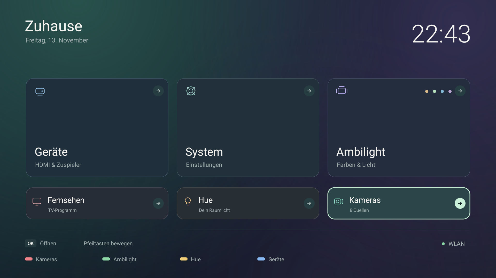
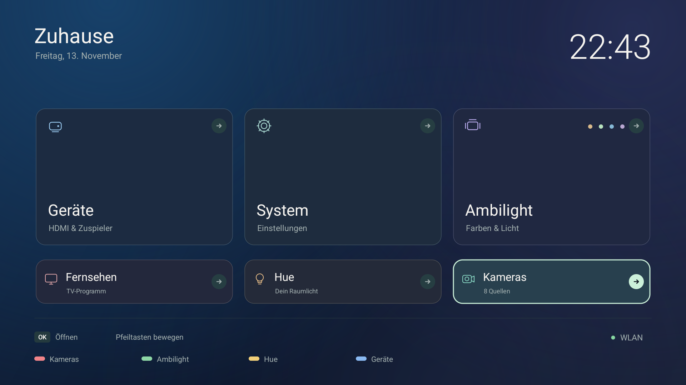
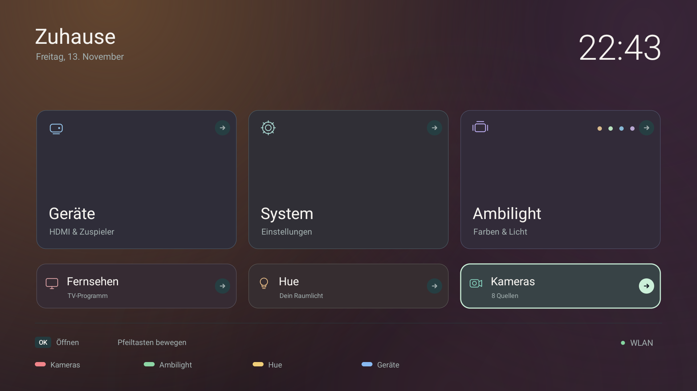
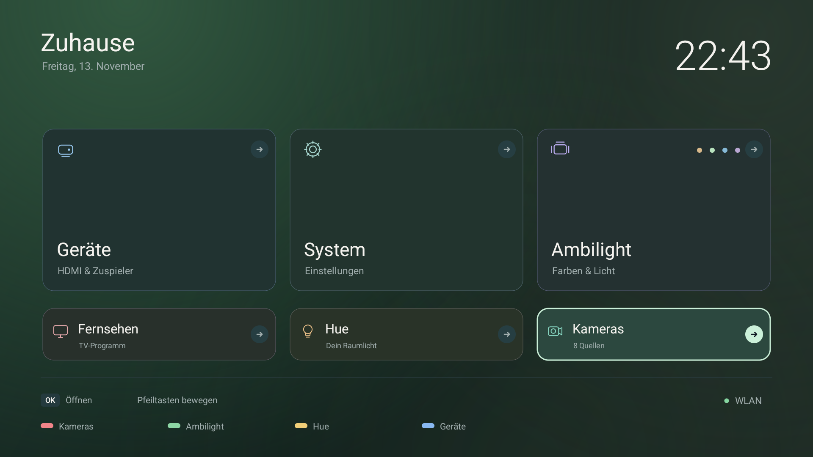
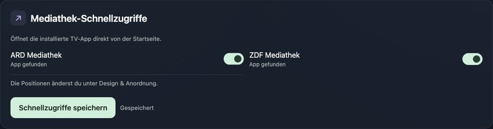

# ATPD

English · [Deutsch](README.de.md)

A lightweight dashboard for Philips Android TV: cameras, Ambilight, Philips Hue, HDMI devices, and TV connectivity, operated with your TV remote.

Install as an Android app and optionally assign it as Home.

**0.11.6 · experimental beta.** Repository documentation is in English; the TV interface and local web settings default to German, with a shared English option. The TV interface has no project name or logo; Android lists the app as **TV-Dashboard**.

## A look at the interface

Native screens captured in an isolated emulator with synthetic cameras, light states, and HDMI entries. These are screenshots of the application, not design mockups. The web screenshots use a separate local preview with synthetic data. No private camera images, access codes, or real network details are shown.


| HDMI devices | Camera overview |
| --- | --- |
|  |  |
| **Ambilight** | **Philips Hue** |
|  |  |
| **System** | **Screensaver** |
|  |  |
| **TV network status** | **Local web settings** |
|  |  |
| **Local UniFi inventory** | **TV info and maintenance** |
|  |  |

[More about the UI and remote navigation](docs/UI.md) · [Apps screenshot](docs/images/apps.png) · [TV info](docs/images/web-tv.jpg) · [Mobile TV info](docs/images/web-tv-mobile.jpg)


<details>
<summary>Four designs with a custom tile order</summary>

| Nordlicht | Mitternacht |
| --- | --- |
|  |  |
| **Abendrot** | **Wald** |
|  |  |

These native emulator screenshots use synthetic data and a reordered Home. The camera tile is in the small row; every destination remains reachable.

</details>

<details>
<summary>Optional ARD / ZDF app shortcuts</summary>



Reviewed web preview with synthetic data. Enable installed media apps under **Startseite**, then arrange them under **Design**. Hue and UniFi can be disabled separately for each TV. App discovery does not establish account or playback readiness.

</details>

## What it does

- Compact phone/tablet settings: a sticky, horizontally scrollable section strip, full-size touch controls, compact Home visibility tiles and expandable setup guidance. [Phone Home](docs/images/web-settings-mobile.jpg) · [Phone Design](docs/images/web-design-mobile.jpg).

- A dedicated web **Design** section for appearance, arrangement, language and fonts. Choose German or English for both dashboards, plus separate clock/text system fonts: default, condensed, serif or monospace. Custom names stay unchanged.

- Four TV designs (**Nordlicht, Mitternacht, Abendrot, Wald**) and movable Home tiles. In web **Design → Design & Anordnung**, drag tiles between rows or use the arrow buttons; choose featured/compact rows or an equal-size grid. Preview/reset stays local until Save. [Editor](docs/images/web-design.jpg).

- Optional Hue standby-off automation in web **Hue → Hue mit dem TV ausschalten**: off by default, targets only the selected room, sends no wake/on command and shows the last attempt result. Actual TV standby acceptance remains pending; power loss or a disconnected bridge cannot be handled reliably.

- A dedicated **Shortcuts** tab with four colour-coded cards, live assignment preview and draft-only default reset. [Desktop](docs/images/web-shortcuts.jpg) · [Phone](docs/images/web-shortcuts-mobile.jpg).

- Four configurable remote color keys: red → Cameras, green → Ambilight, yellow → Hue, blue → Devices by default. Change them in web **Shortcuts → Farbtasten belegen**; shortcuts navigate only within Home/System/Apps.

- A clean Home screen with large focus targets, direct TV access, devices, and system settings.
- Up to 24 configured cameras, six per overview page, with one full-screen stream at a time. The overview retains its page when returning from settings.
- Per-TV Hue/UniFi switches in web Startseite; disabled integrations are hidden and their stored connections/assignments are retained.
- Optional ARD/ZDF Home shortcuts launch the installed TV apps; enable them in web **Startseite → Mediathek-Schnellzugriffe** and arrange them under Design.
- Ambilight modes, 16 named colors, a light preview, and remote/touch brightness control.
- Local Hue Bridge pairing and explicit room selection, with room power, supported colors, brightness, and room-scoped scenes. No Home Assistant is required.
- HDMI discovery through Android's TV input service. Available CEC names identify devices; selecting a card hands the chosen input to the TV's own app.
- Clock or color screensavers, date/dim options, preview, and access to the TV's activation settings.
- Editable TV Home heading and web dashboard name, persisted on the TV. TV-Info shows a separately stored sales model and the Android-reported identifier, independently of those names. Add the sales model under **TV-Modell ergänzen** if Android only reports a platform code; an empty value shows **Nicht hinterlegt**.
- A dedicated web TV-info/maintenance section for Android/app/hardware, uptime, storage, screensaver styling, redacted diagnostics and an explicit dashboard-open request.
- Optional local UniFi Network inventory for adopted Access Points, switches and gateway, with explicit site selection, paginated reads and honest stale/unknown states. Real-controller acceptance is pending. [UniFi setup](docs/NETWORK.md#local-unifi-network-inventory).
- Responsive local HTTPS settings for Home, cameras, Hue pairing/room selection, HDMI inventory, network status and TV information, with PIN login and protected sessions. Camera/Hue configuration stays encrypted on the TV.
- A compact Home network shortcut with a small status dot and active WLAN name when Android supplies it. Green means Android validated internet; amber is unconfirmed and grey is disconnected/unknown. Passive and account-free; this is **TV connectivity, not UniFi site health**. [Network status and limitations](docs/NETWORK.md).

The Hue brightness slider batches input and sends one write for a coalesced gesture. It does not fetch the full room/light/scene catalog after each adjustment. Its value represents the acknowledged target; connection errors retain the previous confirmed view and show an inline message.

## Tested hardware

| Target | Verified scope |
| --- | --- |
| Physical Philips `QM163E`, `mt5890`, Android 8.0.0 / API 26, ARMv7 | Installed application, local settings, retained configuration and native interface; see current device evidence below |
| Physical Philips `TPM191E`, Android 12 / API 31, ARMv7 | Partial second-device validation: installation/start, HTTPS/login, physical Home and Ambilight fixed colors/brightness; stock launcher disabled with owner approval, retained for recovery; video/preset modes remain separate work |
| Philips Hue Bridge `BSB002` | HTTPS identity, pairing, selected room, state reads and a controlled brightness step with restoration |
| Apple TV, identified by HDMI-CEC | Selection and active routing to HDMI 4 verified on the test Philips; generation/firmware were not queried |
| Isolated Android 14 / API 34 ARM64 emulator | UI, navigation and simulated-service checks; not another supported physical TV |

The owner identifies the first TV as **55PUS6581/12**; that marketed number was not independently read from Android. Its 4K panel is distinct from the current **1920 × 1080 Android rendering surface**. [Hardware methods and limits](docs/HARDWARE.md).

## Build and install

Requirements: Python 3, `curl`, JDK 21, Android SDK platform `android-34`, Build Tools `36.1.0`, and Platform Tools. The production APK packages **armeabi-v7a** libraries and requires Android 8 / API 26 or later. Device-specific validation boundaries are listed in the table above.

```sh
python3 app/fetch_deps.py
python3 tests/check_palette.py
python3 app/build.py
adb -s DEVICE install -r dist/TV-Dashboard-0.11.6.apk
adb -s DEVICE shell am start -n de.leisetv/.MainActivity
```

Replace `DEVICE` with the explicitly selected authorized device. Preserve your signing key for future updates. [Installation, Home assignment, update and rollback](docs/INSTALLATION.md).

## First setup

| On the TV | Next step |
| --- | --- |
| **System → Web-Einstellungen** | Open the displayed HTTPS address on your phone/computer and enter the displayed PIN. Confirm the local certificate on first access. |
| Web settings → **Kameras** | Add local UniFi Protect RTSPS sources; existing saved links remain unchanged when a link field is left empty. |
| **Hue → Raum & Bridge** | Enter the bridge address, press its physical button, connect, then choose and confirm the TV room. No whole-home group is selected automatically. |
| Home network shortcut / Web settings → **Netzwerk** | Read the TV connection type and Android internet validation; no UniFi account is required. |
| Web → **Startseite** | Save names/visibility, enable installed ARD/ZDF shortcuts, or disable Hue/UniFi for this TV. Empty names restore defaults. |
| Web → **Design** | Arrange Home tiles and select a design, separate clock/text fonts, and the shared dashboard language. |
| Web → **TV-Info** | Read device facts, configure screensaver styling, download a redacted diagnostic, or explicitly request opening the dashboard. |
| Web → **Netzwerk → UniFi Network** | Enter a local Network API key, validate the connection, then explicitly choose the site. Protect credentials are not reused. |
| **Geräte** | Select a device/HDMI card. Opening the page only discovers sources; it does not switch them. |
| **System → Bildschirmschoner** | Choose a style, date and dim level, or open the full-screen preview. Automatic activation remains a TV/system setting. |

## Validation and limits

Version 0.11.6 adds opt-in ARD/ZDF app shortcuts and upgrades saved six-item orders by retaining their relative order and adding two reserved positions. Both signed builds, 104 web checks and 1,290,240 layout combinations passed. Twenty second-TV API/native assertions verified discovery, save validation, visible tiles, launching both installed apps, Home return and retained settings. ARD initially showed sign-in and ZDF a splash screen; both catalogue/start pages were subsequently observed. Account setup and playback are separate from shortcut launch validation.

Version 0.11.5 adds per-TV Hue/UniFi switches under **Startseite → Funktionen an diesem TV**. Disabled integrations disappear from TV/web navigation and cannot dispatch provider actions; connections and assignments are kept. Both signed builds, 94 web checks, 5,760 layout configurations and 23 final second-TV API/native assertions passed. The synthetic browser passed 320–1280 px without horizontal page overflow. [Feature-switch evidence](docs/STATUS.md#0115-per-tv-hue--unifi-switches).

Version 0.11.4 enables manual Ambilight colors and brightness on TPM191E / Android 12, following the 0.11.3 HTTPS fix. Both signed builds, 29 controller checks, 53 palette checks and 78 web checks passed. The second TV passed 24 GUI checks for RGB colors, brightness, focus and pixel stability, plus six installation/API checks. Native video/preset modes remain separate work; device-reported LED colors are not calibrated wall-color evidence. [Device results](docs/STATUS.md#0114-tpm191e-manual-ambilight-colors-and-brightness).

Version 0.11.2 passed **78** web state/payload checks, including independent shortcut drafts, preview, default reset, in-flight locking and failed-save recovery. Browser checks covered the new editor at 320–1280 px, English/monospace, custom save/reload and all eight tabs at 320 px without horizontal body overflow. Nine physical installation/API checks passed with existing assignments and foreground retained; earlier native/provider results keep their separate scope in [current status](docs/STATUS.md).

Slow, stale and failing Hue replies are included, as are pixel comparisons outside the brightness slider. [Reproduce the tests](docs/TESTING.md). [Current device results and known limits](docs/STATUS.md).

Other TV models, authenticated HTTPS-only Ambilight adapters, extended live-camera switching, and automatic screensaver activation on this Philips remain outside the completed validation scope. The Philips intercepts the standard screensaver settings intent, so the app explains the limitation and offers general TV settings. This is a beta, with no universal frame-rate or compatibility claim.

## Proposed next steps

[Roadmap](docs/ROADMAP.md) records the discussed extensions, prerequisites and acceptance boundaries. The suggested starting order is direct favourites, shared lighting presets, then combined actions such as Filmabend. Smart-home widgets, a UniFi summary, portable settings, guided updates, first-run setup and doorbell previews are also proposals, not delivered features or scheduled releases.

## Documentation

[Documentation index](docs/README.md) · [UI](docs/UI.md) · [Architecture and data](docs/ARCHITECTURE.md) · [Installation](docs/INSTALLATION.md) · [Testing](docs/TESTING.md) · [Status](docs/STATUS.md) · [Hardware](docs/HARDWARE.md) · [Network](docs/NETWORK.md) · [Roadmap](docs/ROADMAP.md) · [Changelog](CHANGELOG.md)

## Licensing

LibVLC 3.7.7 is used under LGPL 2.1; its pinned archive is verified when fetched. See [third-party notices](app/assets/THIRD-PARTY-NOTICES.txt) and [LGPL 2.1](app/assets/LGPL-2.1.txt). No separate license has yet been selected for the project's own code.
