# ATPD

English · [Deutsch](README.de.md)

A lightweight dashboard for Philips Android TV: cameras, Ambilight, Philips Hue, HDMI devices, and TV connectivity, operated with your TV remote.

Install as an Android app and optionally assign it as Home.

**0.8.1 · experimental beta.** Repository documentation is in English; the TV interface and local web settings are in German. The TV interface has no project name or logo; Android lists the app as **TV-Dashboard**.

## A look at the interface

Native screens captured in an isolated emulator with synthetic cameras, light states, and HDMI entries. These are screenshots of the application, not design mockups. The web screenshots use a separate local preview with synthetic data. No private camera images, access codes, or real network details are shown.

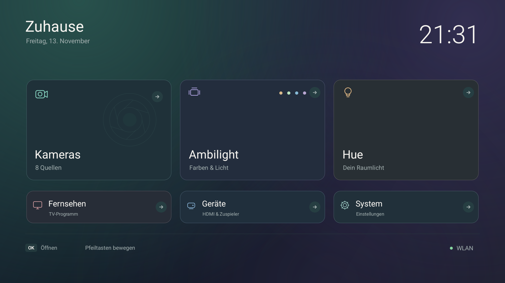

| HDMI devices | Camera overview |
| --- | --- |
| 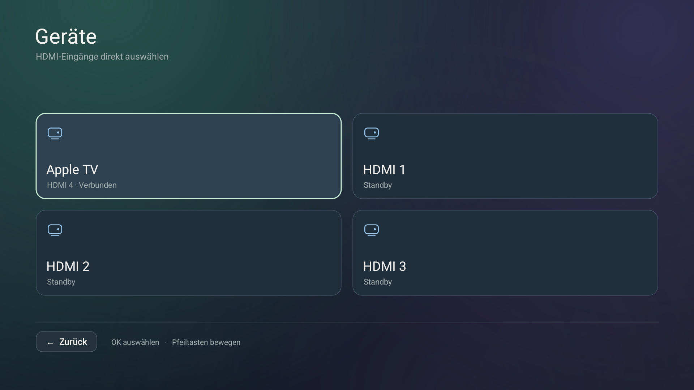 | 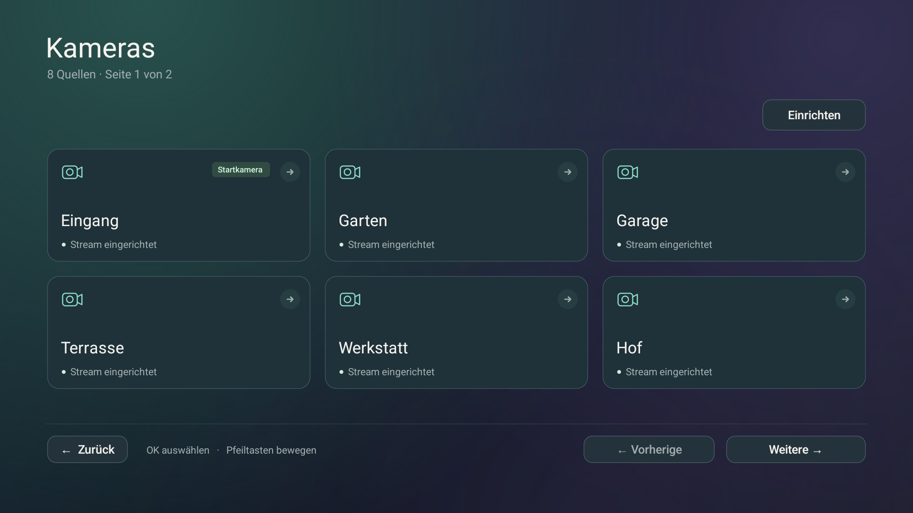 |
| **Ambilight** | **Philips Hue** |
| 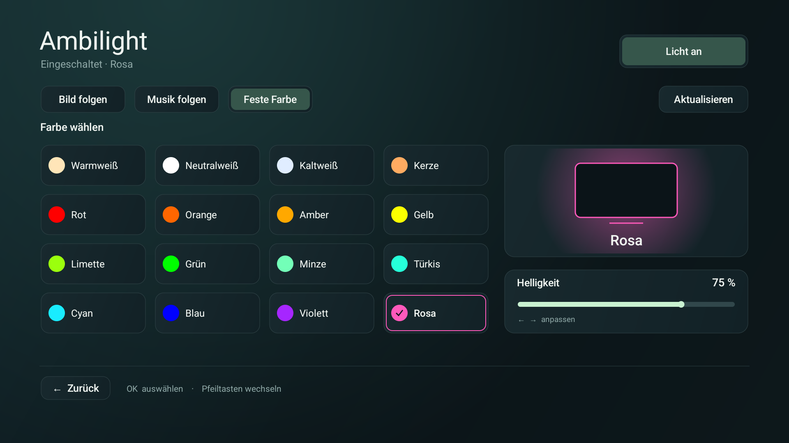 | 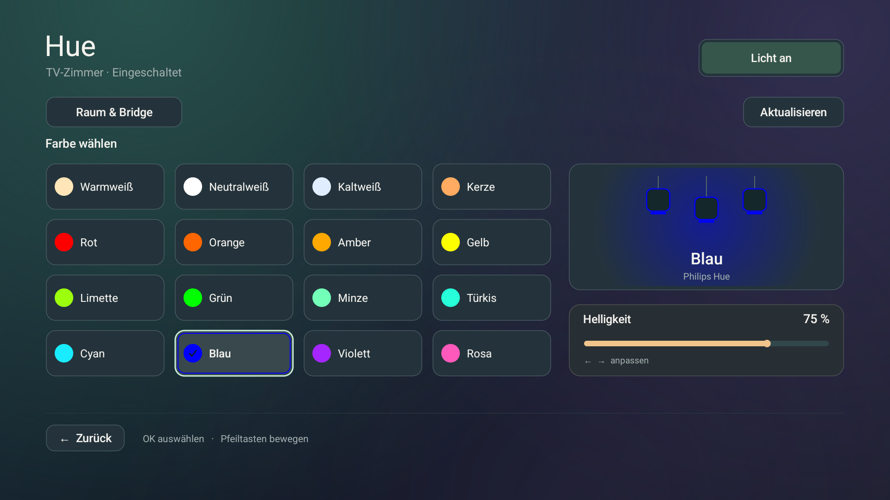 |
| **System** | **Screensaver** |
| 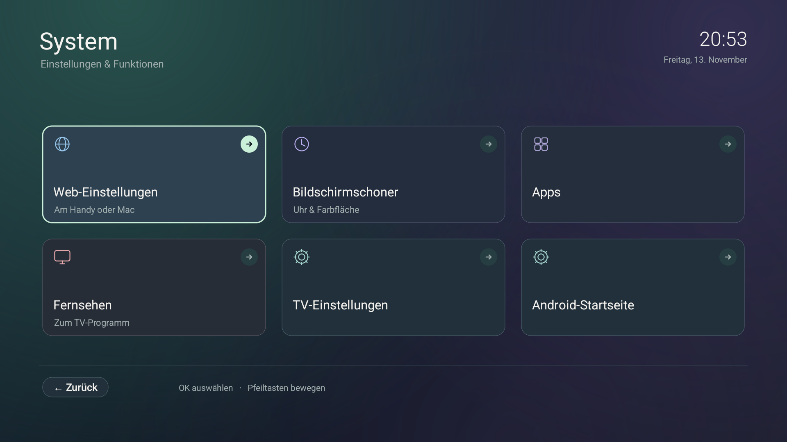 | 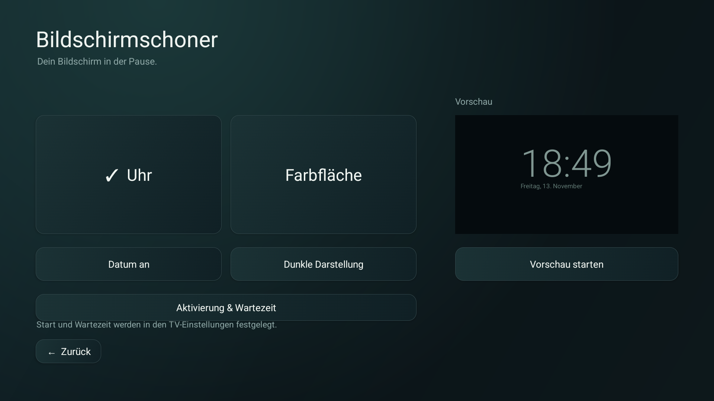 |
| **TV network status** | **Local web settings** |
| 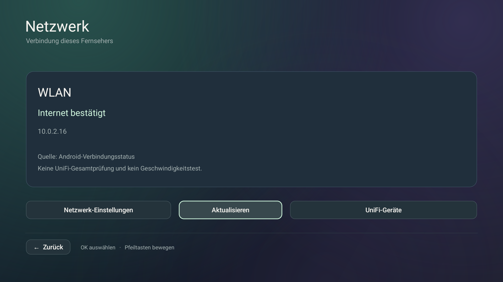 | 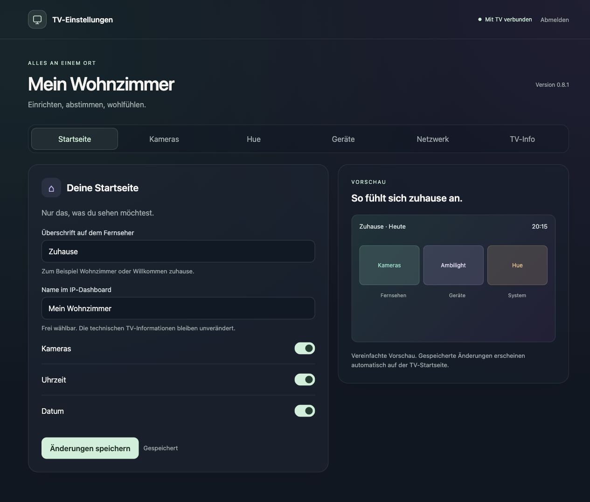 |
| **Local UniFi inventory** | **TV info and maintenance** |
| 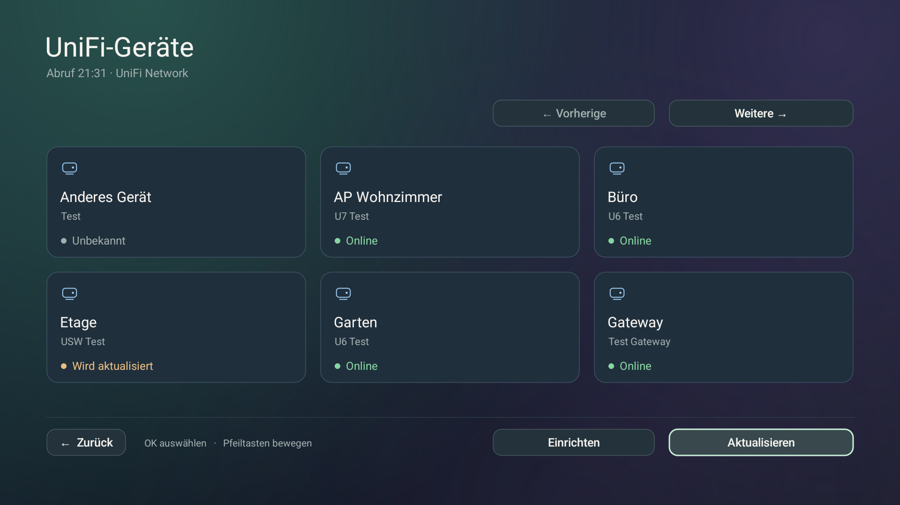 | 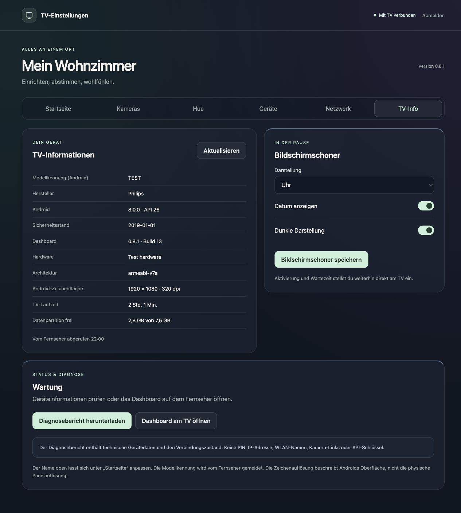 |

[More about the UI and remote navigation](docs/UI.md) · [Apps screenshot](docs/images/apps.png) · [TV info](docs/images/web-tv.jpg) · [Mobile TV info](docs/images/web-tv-mobile.jpg)

## What it does

- A clean Home screen with large focus targets, direct TV access, devices, and system settings.
- Up to 24 configured cameras, six per overview page, with one full-screen stream at a time. The overview retains its page when returning from settings.
- Ambilight modes, 16 named colors, a light preview, and remote/touch brightness control.
- Local Hue Bridge pairing and explicit room selection, with room power, supported colors, brightness, and room-scoped scenes. No Home Assistant is required.
- HDMI discovery through Android's TV input service. Available CEC names identify devices; selecting a card hands the chosen input to the TV's own app.
- Clock or color screensavers, date/dim options, preview, and access to the TV's activation settings.
- Editable TV Home heading and web dashboard name, persisted on the TV. TV-Info always uses the Android-reported model identifier, independently of those names.
- A dedicated web TV-info/maintenance section for Android/app/hardware, uptime, storage, screensaver styling, redacted diagnostics and an explicit dashboard-open request.
- Optional local UniFi Network inventory for adopted Access Points, switches and gateway, with explicit site selection, paginated reads and honest stale/unknown states. Real-controller acceptance is pending. [UniFi setup](docs/NETWORK.md#local-unifi-network-inventory).
- Responsive local HTTPS settings for Home, cameras, Hue pairing/room selection, HDMI inventory, network status and TV information, with PIN login and protected sessions. Camera/Hue configuration stays encrypted on the TV.
- A compact Home network shortcut with a small status dot and active WLAN name when Android supplies it. Green means Android validated internet; amber is unconfirmed and grey is disconnected/unknown. Passive and account-free; this is **TV connectivity, not UniFi site health**. [Network status and limitations](docs/NETWORK.md).

The Hue brightness slider batches input and sends one write for a coalesced gesture. It does not fetch the full room/light/scene catalog after each adjustment. Its value represents the acknowledged target; connection errors retain the previous confirmed view and show an inline message.

## Tested hardware

| Target | Verified scope |
| --- | --- |
| Physical Philips `QM163E`, `mt5890`, Android 8.0.0 / API 26, ARMv7 | Installed application, local settings, retained configuration and native interface; see current device evidence below |
| Philips Hue Bridge `BSB002` | HTTPS identity, pairing, selected room, state reads and a controlled brightness step with restoration |
| Apple TV, identified by HDMI-CEC | Selection and active routing to HDMI 4 verified on the test Philips; generation/firmware were not queried |
| Isolated Android 14 / API 34 ARM64 emulator | UI, navigation and simulated-service checks; not another supported physical TV |

The owner identifies the TV as **55PUS6581/12**; that marketed number was not independently read from Android. Its 4K panel is distinct from the current **1920 × 1080 Android rendering surface**. [Hardware methods and limits](docs/HARDWARE.md).

## Build and install

Requirements: Python 3, `curl`, JDK 21, Android SDK platform `android-34`, Build Tools `36.1.0`, and Platform Tools. The production APK packages **armeabi-v7a** libraries and requires Android 8 / API 26 or later; other physical models remain unverified.

```sh
python3 app/fetch_deps.py
python3 tests/check_palette.py
python3 app/build.py
adb -s DEVICE install -r dist/TV-Dashboard-0.8.1.apk
adb -s DEVICE shell am start -n de.leisetv/.MainActivity
```

Replace `DEVICE` with the explicitly selected authorized device. Preserve your signing key for future updates. [Installation, Home assignment, update and rollback](docs/INSTALLATION.md).

## First setup

| On the TV | Next step |
| --- | --- |
| **System → Web-Einstellungen** | Open the displayed HTTPS address on your phone/computer and enter the displayed PIN. Confirm the local certificate on first access. |
| Web settings → **Kameras** | Add local UniFi Protect RTSPS sources; existing saved links remain unchanged when a link field is left empty. |
| **Hue → Raum & Bridge** | Enter the bridge address, press its physical button, connect, then choose and confirm the TV room. No whole-home group is selected automatically. |
| Home network shortcut / Web settings → **Netzwerk** | Read the TV connection type and Android internet validation; no UniFi account is required. |
| Web → **Startseite** | Save the Home heading and dashboard name; an empty name restores the default. |
| Web → **TV-Info** | Read device facts, configure screensaver styling, download a redacted diagnostic, or explicitly request opening the dashboard. |
| Web → **Netzwerk → UniFi Network** | Enter a local Network API key, validate the connection, then explicitly choose the site. Protect credentials are not reused. |
| **Geräte** | Select a device/HDMI card. Opening the page only discovers sources; it does not switch them. |
| **System → Bildschirmschoner** | Choose a style, date and dim level, or open the full-screen preview. Automatic activation remains a TV/system setting. |

## Validation and limits

The 0.8.1 fix passed **31** web state/payload checks, including renaming without changing technical model information. The previous 0.8.0 increment passed **53** production palette checks, **10** UniFi adapter fixture checks, **10** native inventory checks, **6** passive network UI checks and **11** screensaver checks. Earlier Hue/Ambilight/navigation coverage is retained separately in the status/history documents. These are scoped results, not a complete device certification. Real UniFi-controller acceptance is pending.

Slow, stale and failing Hue replies are included, as are pixel comparisons outside the brightness slider. [Reproduce the tests](docs/TESTING.md). [Current device results and known limits](docs/STATUS.md).

Other TV models, authenticated HTTPS-only Ambilight adapters, extended live-camera switching, and automatic screensaver activation on this Philips remain outside the completed validation scope. The Philips intercepts the standard screensaver settings intent, so the app explains the limitation and offers general TV settings. This is a beta, with no universal frame-rate or compatibility claim.

## Documentation

[Documentation index](docs/README.md) · [UI](docs/UI.md) · [Architecture and data](docs/ARCHITECTURE.md) · [Installation](docs/INSTALLATION.md) · [Testing](docs/TESTING.md) · [Status](docs/STATUS.md) · [Hardware](docs/HARDWARE.md) · [Network](docs/NETWORK.md) · [Changelog](CHANGELOG.md)

## Licensing

LibVLC 3.7.7 is used under LGPL 2.1; its pinned archive is verified when fetched. See [third-party notices](app/assets/THIRD-PARTY-NOTICES.txt) and [LGPL 2.1](app/assets/LGPL-2.1.txt). No separate license has yet been selected for the project's own code.
