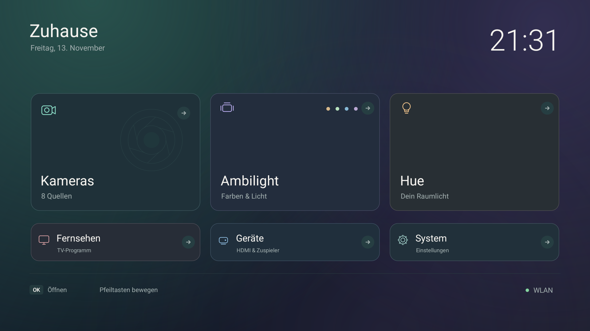
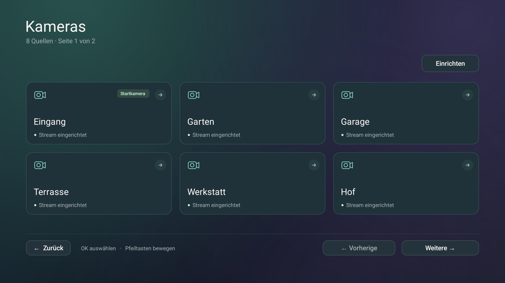
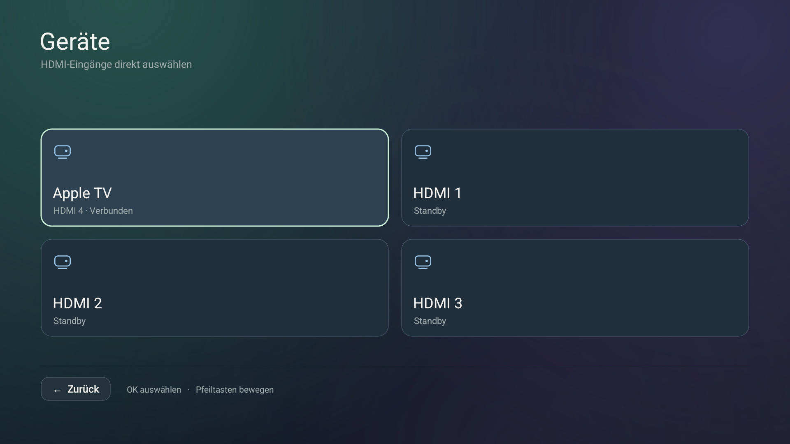
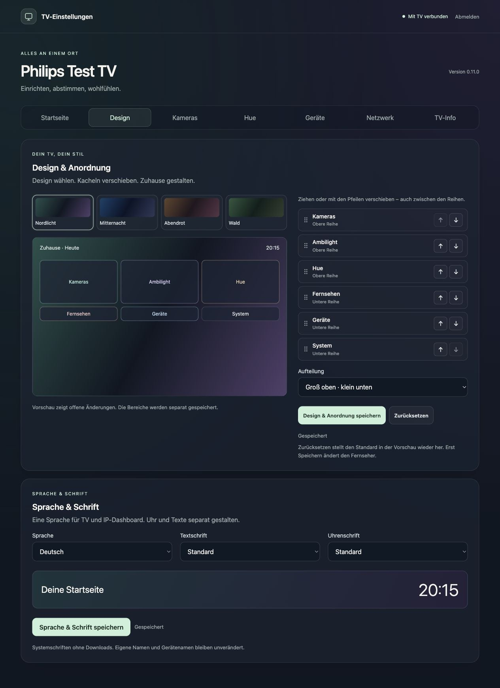
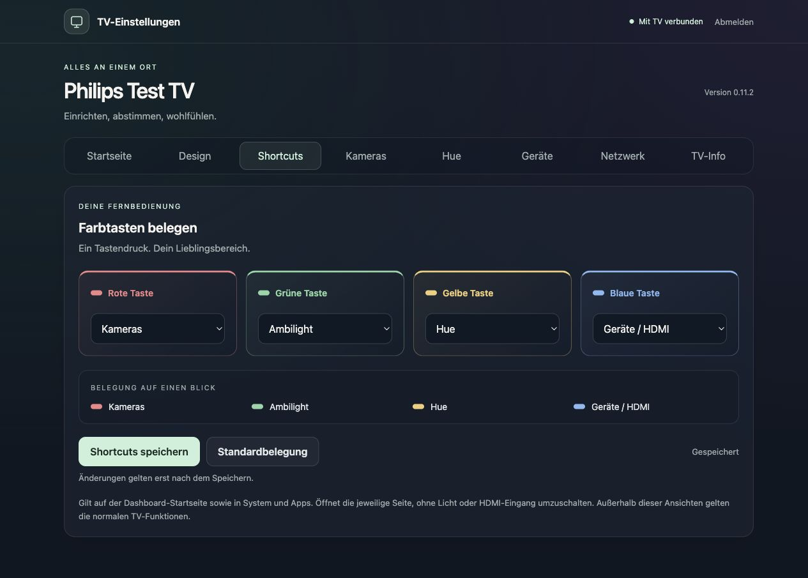

# TV interface and remote control

[Documentation](README.md)

## Screens

| Screen | Main actions |
| --- | --- |
| Home | Four to eight visible destinations, with featured/compact or equal-size rows; custom Home title and compact network badge |
| Cameras | Six cards per page, previous/next page, setup and Back; up to 24 sources |
| Ambilight | 16 colors, modes, power, light preview and fixed-color brightness |
| Hue | One explicitly selected room, colors, power, brightness and available room scenes |
| Devices | Android-provided HDMI ports/devices, CEC/custom labels and connection states |
| System | Local web access, screensaver, Apps, TV settings and the retained Android launcher |
| Apps | Installed TV apps, page controls and Back to System |
| Screensaver | Clock/color style, date/dim controls, preview and system activation settings |
| Web access | Local address and access PIN, displayed only on this dedicated screen |
| Camera player | Existing video path with smaller consistent title/help badges |

Native screenshots use the application in an isolated emulator with synthetic data; web screenshots use a separate local preview with synthetic data. The HDMI gallery uses instrumentation to render synthetic entries; its fake IDs cannot launch a real input. This is separate from actual Philips discovery and selection checks. The public gallery contains no camera video, access PIN, bridge key or personal address.

The fresh 0.11.7 baseline follows the primary TV: Ambilight / Cameras / Hue above Television / Devices / System, Nordlicht and German/default fonts. ARD/ZDF tiles are opt-in, with independent Hue/UniFi switches. Existing saved orders and location choices remain unchanged on update. [Configure another location](INSTALLATION.md#shared-project-baseline-and-per-tv-settings).

## Navigation

- Arrow keys move the visible focus border; OK activates the focused card.
- Left/Right on a brightness slider adjust brightness in five-percentage-point steps for Hue. Touch dragging sends the final position; held/repeated keys are coalesced.
- Up/Down leave a slider. Focus stays in place while a command is pending; acknowledgements do not pull focus back after the user moves elsewhere.
- A color's selection marker shows the acknowledged state. The mint focus border shows where the remote is pointing; the two are distinct.
- Back closes dialogs/previews, returns from Apps to System, from System to Home, or from a child activity to its caller. Home opens the configured dashboard Home screen.
- The camera overview retains its selected source/page and reuses its view when the configuration is unchanged.

## Color accents

The background remains a single static cached image. Semantic accents distinguish cameras (teal), Ambilight (lilac), Hue (gold), devices/web access (blue), TV (soft rose), and system controls (aqua). Card fills use subtle solid tints. Text stays light, focus stays mint, and actual light-color swatches retain their protocol-correct values. No color cycling or extra animation is introduced.

## Stable rendering

Ambilight fixed colors are enabled only for an explicitly advertised `MANUAL_HUE` capability. Both `FOLLOW_COLOR` and the TPM191E's `Lounge light` use the same palette/preview. Select a color with OK, then focus **Helligkeit** and use Left/Right; Up/Down leave the slider. Brightness becomes available after a manual color is confirmed. Updates preserve the raw TV style name, exact hue/saturation bytes and slider focus; a mismatched level readback is reported as unconfirmed. An incomplete video descriptor leaves **Bild folgen** unavailable. Native Philips preset switching is separate from these manual colors.

The screens share a 1920 × 1080 virtual canvas, spacing, typography, rounded cards and static icons. The canvas scales uniformly to the Android display. `TvStyle` retains one ARGB background bitmap (approximately 8 MiB) and cached typefaces per process. Cards use solid fills and explicit focus strokes rather than allocating gradients or playing default button state animations on every update.

Home's clock updates once per minute. Screensaver clock work is stopped when its settings page is paused. Hue has no background polling. Its brightness path sends a coalesced write, retains the confirmed target, and redraws the slider; it does not reload the room/light/scene catalog or disable the page on each step. Failures show an inline unconfirmed-change message while retaining the last confirmed controls.

These measures reduce unnecessary drawing and network work. They are not a frame-rate guarantee for every Android TV driver or firmware. [Test methods and limits](TESTING.md).

## Device behavior

Web **Startseite → Mediathek-Schnellzugriffe** offers independent **ARD Mediathek** and **ZDF Mediathek** switches with installed-app status. Save adds/removes their TV tiles; it does not open, install or authenticate the provider apps. Position both under **Design & Anordnung**, including across rows. Optional tiles default off on other installations. The TV's OK action launches the local app, and Home returns through the configured dashboard assignment. Provider onboarding and playback stay in the provider app.

Web **Startseite → Funktionen an diesem TV** provides separate **Philips Hue** and **UniFi Network** switches and an explicit Save. Changes remain drafts until saved. Disabling Hue removes its TV tile and web tab, suppresses its shortcut actions/legend and pauses its standby automation. Disabling UniFi removes the native entry/web inventory without hiding the TV's own network status. Connections, tile positions and raw key assignments remain saved; re-enabling does not pair or send provider actions. With both cameras and Hue hidden, Home uses two destinations per row. A disabled saved Hue shortcut is shown as inactive in the editor with a separate explanation.

Opening Devices only discovers inputs. A click revalidates the selected input and starts the native TV app with Android's passthrough channel URI and channel MIME type. CEC/custom labels and connection state come from the TV service. State labels are reported framework values, not a fresh electrical or calibrated device-power measurement. A retained selection means **last chosen**, not a continuous proof of the currently active physical source. Unchanged callbacks do not rebuild the page.

## Screensaver activation

The app's clock/color styles and preview do not silently enable an automatic screensaver or change its timing. This Philips intercepts the Android dream-settings intent. A dialog explains that limitation and links to general TV settings; automatic idle activation remains unverified on the physical TV.

## Network and local web settings

The Home footer contains a small focusable status dot/name without an idle card or arrow; Down from the lower shortcut row reaches it and OK opens the native network detail page. Refresh keeps focus. Android capability callbacks update only the visible status card/button. Network settings open only after the user selects that explicit action. No UniFi site-wide assertion or signal-strength estimate is shown.

The local web page carries the same teal/purple background and mint focus accents, with teal cameras, warm Hue and blue device/network areas. Eight responsive sections share consistent spacing, keyboard-accessible tabs (Left/Right/Home/End) and explicit save feedback. At 320/390 px cards stack and action headings wrap. Existing camera streamlinks are not returned into a field; deletion names the source in a confirmation dialog. [Web screenshot](images/web-settings.jpg) · [Mobile network screenshot](images/web-network-mobile.jpg).

The web Startseite form stores two distinct names: the Home heading on the TV (40 characters, empty restores Zuhause), and the web dashboard name (80 characters, empty restores Android manufacturer/model). Long native headings ellipsize before the clock; long web labels wrap. Changing a friendly label does not change hardware identity.

TV-Info lists an optional stored sales model, manufacturer/platform model, Android/API/security patch, app version/build, hardware/ABI, Android drawing area/density, boot uptime and free/total data-partition storage. Screensaver style/date/dim are editable there and notify attached native preview views. Activation/timing remain system settings. Device facts exclude the dashboard name. Diagnostic export additionally excludes the stored sales model and contains only the technical whitelist plus transport/validation, without IP/SSID/credentials. A dashboard-open request is explicit and has a browser confirmation because it can leave the currently watched TV view.

UniFi inventory is reached through the network detail page. Native cards are read-only, six per page. Setup and refresh remain explicit; failure retains grey historical labels and a timestamp. [UniFi screenshot](images/unifi.png) · [TV-info screenshot](images/web-tv.jpg).

The editable field is named **Name im IP-Dashboard**. It affects the page heading/title only. **Modellkennung (Android)** in TV-Info comes from `Build.MODEL`, and changing either user-defined name cannot change it. Android can report a platform code (for example QM163E) rather than a marketed product number; the UI does not guess the latter.

Since 0.8.2, **TV-Modell** is a separate stored sales designation. **TV-Modell ergänzen** accepts up to 80 characters from the type label; an empty entry clears it and shows **Nicht hinterlegt**. Saving it preserves unsaved screensaver edits. It does not change the heading or the Android identifier.

## Color-key shortcuts

On Home, System and Apps, red/green/yellow/blue navigate to Cameras/Ambilight/Hue/Devices by default. A small color-and-text legend appears below the Home navigation hints. The web Shortcuts section stores all four mappings separately from the Home form; available destinations are Cameras, Ambilight, Hue, Devices, Network, System, Apps and disabled. Saving preserves unrelated unsaved Home edits. Disabled keys have no Home legend entry. Hiding cameras also hides their legend and blocks that shortcut.

Only the first uncancelled key-down navigates; repeats and key-up are consumed. Other Dashboard detail pages, external apps and TV/HDMI viewing retain their own key handling. Shortcuts open pages, never perform lighting/source/playback commands directly. A TV may intercept the hardware keys before delivering Android events; injected-key checks do not certify a physical remote.

[Web shortcut settings on mobile](images/web-settings-mobile.jpg).

## Hue standby off

Web **Hue → Hue mit dem TV ausschalten** contains the optional **Hue beim Ausschalten des Fernsehers ausschalten** switch and a separate Save button. It defaults off and requires an existing paired Bridge and selected room/zone. Saving only stores a preference; the next observed standby transition may send one off command to that selected group. Waking does not switch lights on. Room changes use the same existing explicit Hue-room selection.

The panel reports the last recorded attempt as confirmed by the bridge, unconfirmed, or skipped after state/configuration changes. Results refresh when the Hue section is opened or the page reloaded. The normal bridge refresh button belongs to its separate setup card. All controls remain available to disable a previously enabled option even if the stored setup becomes invalid.

[Hue automation settings](images/web-hue.jpg) · [Mobile](images/web-hue-mobile.jpg). Images use synthetic data with the option enabled for demonstration; the physical TV remains disabled until the owner enables it.

## Designs and Home arrangement

Web **Design → Design & Anordnung** provides four designs: Nordlicht (the original look), Mitternacht (blue), Abendrot (warm brown/rose) and Wald (green). The theme changes shared native backgrounds/card surfaces, preserving light preset colors, text/focus contrast and controls. The web administration itself retains its current style.

Drag any of the eight reserved Home destinations to a new slot, including across rows, or use its **nach vorne/nach hinten** buttons. The arrow buttons retain keyboard focus after moving. Choose **Groß oben · klein unten** or **Alle Kacheln gleich groß**. The header/clock, network badge and color-key legend retain their fixed TV-safe locations. This is a bounded grid editor, not arbitrary pixel coordinates or a custom-app launcher.

The preview reflects the current draft, including unsaved Home names/visibility; those fields still use their own Save button. Appearance saves preserve other drafts. **Zurücksetzen** restores the appearance draft to Nordlicht/default order/featured layout; the TV changes only after explicit Save. Pending saves reject conflicting reorder/theme/layout edits.

Hiding cameras removes their visible tile and preview, while retaining their chosen stored slot. Re-enabling restores that position. With five visible tiles the featured layout uses two large/three compact tiles; equal mode uses three/two, filling the width. Live Home updates preserve the focused destination where still visible; explicit Home navigation starts at the first configured tile. Detail-page theme updates invalidate drawing without recreating controls or sending commands.

[Mobile editor](images/web-design-mobile.jpg) · [Four native designs](../README.md#a-look-at-the-interface).

## Shared language and independent fonts (0.11.0)

The dedicated **Design** tab groups the theme/order editor and **Sprache & Schrift**. **Startseite** retains names and visibility; since 0.11.2, remote color shortcuts live in their own **Shortcuts** tab. A complete explicit Save selects German or English for both dashboards and independent default/condensed/serif/monospace fonts for body text and the clock. Clock/date in Home and the screensaver follow the same choices. The web font sample and Home preview show unsaved choices without changing the TV.

Only app-owned labels are translated. User headings, camera names, Hue rooms/scenes, SSIDs, app labels and provider/device names stay literal, even when a name matches a German menu word. A stored Home name such as Zuhause remains a custom name; only an unset default is localized. Android/Philips settings and third-party apps keep their own language.

The saving web session updates immediately. Other browser sessions pick up the shared setting on reload. Native Home preserves its focused destination. An open native detail activity is recreated on a language/font change, so an open dialog or transient player view can close/restart; ordinary theme-only updates still preserve detail controls. This explicit settings action is separate from the stable brightness-slider path. Browser system-font fallbacks can differ from Android glyphs.

## Compact administration (0.11.1)

The web page uses a narrower desktop content width and smaller card/heading spacing. Up to 900 px, the seven sections become a sticky, horizontally scrollable strip. Touch swipe reveals additional sections; keyboard Left/Right/Home/End retains roving focus and scrolls the selected tab into view. Switching from a stuck strip brings the new panel into view. Navigation changes do not reset independent drafts.

The phone header omits the decorative eyebrow/tagline and keeps the TV name/version. Home visibility choices form three compact labelled switch tiles. Inputs retain a 16 px font and 48 px height; order-arrow buttons have 44 px touch targets. Mobile save actions span their card. Theme swatches, the TV preview, font selectors, facts and device rows use less space while allowing text wrapping. Safe-area insets and reduced-motion preferences are respected.

Camera, Hue and connectivity explanations remain available in expandable, translated guidance sections. Hue automation and UniFi inventory precede their guidance in both DOM and visual order. No pairing, light/input action or background polling is added.

At the same 390 px synthetic fixture, the first Home form moved from approximately 419 px to 215 px; total initial Home scroll height decreased from about 1772 px to 1340 px (around 24%). Browser scrollbar/font settling can shift these values. These are layout measurements, not a general performance benchmark or physical-phone certification.

[Phone Home](images/web-settings-mobile.jpg) · [Phone Design](images/web-design-mobile.jpg) · [Phone network](images/web-network-mobile.jpg).

## Dedicated shortcut editor (0.11.2)

**Shortcuts → Farbtasten belegen** contains four colour-coded cards with labelled destination selectors. Four columns fit wide desktops, two fit tablets and one fits narrow phones. A translated preview shows the current draft, including explicitly disabled keys. If the saved Home visibility hides cameras, a contextual note explains why camera shortcuts are inactive; an unsaved Home visibility draft does not change that fact.

**Standardbelegung** restores Cameras/Ambilight/Hue/Devices in the draft only. **Shortcuts speichern** is the explicit commit. Selectors/reset are locked during a save; a failed save releases controls and retains the draft. Saving Home, cameras, design or language does not discard independent shortcut drafts. The Home tab contains only names and visibility.

[Phone view](images/web-shortcuts-mobile.jpg). Native key handling and its Home/System/Apps scope are unchanged; physical remote forwarding remains a separate validation boundary.
