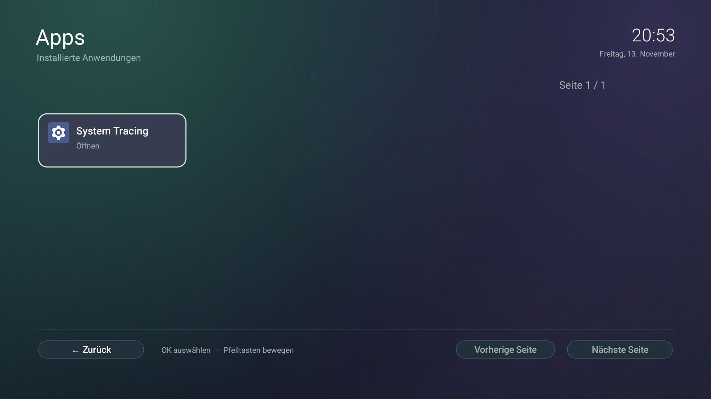

# TV interface and remote control

[Documentation](README.md)

## Screens

| Screen | Main actions |
| --- | --- |
| Home | Cameras, Ambilight and Hue; TV, HDMI devices and System below |
| Cameras | Six cards per page, previous/next page, setup and Back; up to 24 sources |
| Ambilight | 16 colors, modes, power, light preview and fixed-color brightness |
| Hue | One explicitly selected room, colors, power, brightness and available room scenes |
| Devices | Android-provided HDMI ports/devices, CEC/custom labels and connection states |
| System | Local web access, screensaver, Apps, TV settings and the retained Android launcher |
| Apps | Installed TV apps, page controls and Back to System |
| Screensaver | Clock/color style, date/dim controls, preview and system activation settings |
| Web access | Local address and access PIN, displayed only on this dedicated screen |
| Camera player | Existing video path with smaller consistent title/help badges |

Native screenshots use the application in an isolated emulator with synthetic data; web screenshots use a separate local preview with synthetic data. The HDMI gallery uses instrumentation to render synthetic entries; its fake IDs cannot launch a real input. This is separate from actual Philips discovery and selection checks. The public gallery contains no camera video, access PIN, bridge key or personal address.

## Navigation

- Arrow keys move the visible focus border; OK activates the focused card.
- Left/Right on a brightness slider adjust brightness in five-percentage-point steps for Hue. Touch dragging sends the final position; held/repeated keys are coalesced.
- Up/Down leave a slider. Focus stays in place while a command is pending; acknowledgements do not pull focus back after the user moves elsewhere.
- A color's selection marker shows the acknowledged state. The mint focus border shows where the remote is pointing; the two are distinct.
- Back closes dialogs/previews, returns from Apps to System, from System to Home, or from a child activity to its caller. Home opens the configured dashboard Home screen.
- The camera overview retains its selected source/page and reuses its view when the configuration is unchanged.

## Color accents

The background remains a single static cached image. Semantic accents distinguish cameras (teal), Ambilight (lilac), Hue (gold), devices/web access (blue), TV (soft rose), and system controls (aqua). Card fills use subtle solid tints. Text stays light, focus stays mint, and actual light-color swatches retain their protocol-correct values. No color cycling or extra animation is introduced.

## Stable rendering

The screens share a 1920 × 1080 virtual canvas, spacing, typography, rounded cards and static icons. The canvas scales uniformly to the Android display. `TvStyle` retains one ARGB background bitmap (approximately 8 MiB) and cached typefaces per process. Cards use solid fills and explicit focus strokes rather than allocating gradients or playing default button state animations on every update.

Home's clock updates once per minute. Screensaver clock work is stopped when its settings page is paused. Hue has no background polling. Its brightness path sends a coalesced write, retains the confirmed target, and redraws the slider; it does not reload the room/light/scene catalog or disable the page on each step. Failures show an inline unconfirmed-change message while retaining the last confirmed controls.

These measures reduce unnecessary drawing and network work. They are not a frame-rate guarantee for every Android TV driver or firmware. [Test methods and limits](TESTING.md).

## Device behavior

Opening Devices only discovers inputs. A click revalidates the selected input and starts the native TV app with Android's passthrough channel URI and channel MIME type. CEC/custom labels and connection state come from the TV service. State labels are reported framework values, not a fresh electrical or calibrated device-power measurement. A retained selection means **last chosen**, not a continuous proof of the currently active physical source. Unchanged callbacks do not rebuild the page.

## Screensaver activation

The app's clock/color styles and preview do not silently enable an automatic screensaver or change its timing. This Philips intercepts the Android dream-settings intent. A dialog explains that limitation and links to general TV settings; automatic idle activation remains unverified on the physical TV.

## Network and local web settings

The Home footer contains a small focusable status dot/name without an idle card or arrow; Down from the lower shortcut row reaches it and OK opens the native network detail page. Refresh keeps focus. Android capability callbacks update only the visible status card/button. Network settings open only after the user selects that explicit action. No UniFi site-wide assertion or signal-strength estimate is shown.

The local web page carries the same teal/purple background and mint focus accents, with teal cameras, warm Hue and blue device/network areas. Six responsive sections share consistent spacing, keyboard-accessible tabs (Left/Right/Home/End) and explicit save feedback. At 320/390 px cards stack and action headings wrap. Existing camera streamlinks are not returned into a field; deletion names the source in a confirmation dialog. [Web screenshot](images/web-settings.jpg) · [Mobile network screenshot](images/web-network-mobile.jpg).

The web Startseite form stores two distinct names: the Home heading on the TV (40 characters, empty restores Zuhause), and the web dashboard name (80 characters, empty restores Android manufacturer/model). Long native headings ellipsize before the clock; long web labels wrap. Changing a friendly label does not change hardware identity.

TV-Info lists an optional stored sales model, manufacturer/platform model, Android/API/security patch, app version/build, hardware/ABI, Android drawing area/density, boot uptime and free/total data-partition storage. Screensaver style/date/dim are editable there and notify attached native preview views. Activation/timing remain system settings. Device facts exclude the dashboard name. Diagnostic export additionally excludes the stored sales model and contains only the technical whitelist plus transport/validation, without IP/SSID/credentials. A dashboard-open request is explicit and has a browser confirmation because it can leave the currently watched TV view.

UniFi inventory is reached through the network detail page. Native cards are read-only, six per page. Setup and refresh remain explicit; failure retains grey historical labels and a timestamp. [UniFi screenshot](images/unifi.png) · [TV-info screenshot](images/web-tv.jpg).

The editable field is named **Name im IP-Dashboard**. It affects the page heading/title only. **Modellkennung (Android)** in TV-Info comes from `Build.MODEL`, and changing either user-defined name cannot change it. Android can report a platform code (for example QM163E) rather than a marketed product number; the UI does not guess the latter.

Since 0.8.2, **TV-Modell** is a separate stored sales designation. **TV-Modell ergänzen** accepts up to 80 characters from the type label; an empty entry clears it and shows **Nicht hinterlegt**. Saving it preserves unsaved screensaver edits. It does not change the heading or the Android identifier.
